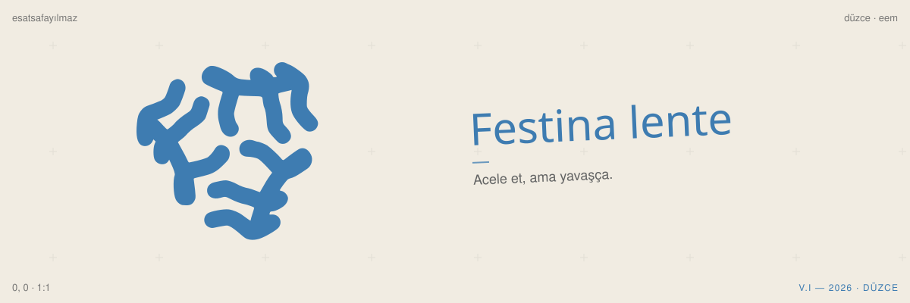

*Nulla dies sine linea*
Çizgisiz gün olmasın.

düzce · elektrik-elektronik mühendisliği

### şu sıralar

- [safetynet](https://github.com/xescype/safetynet) · aile apartmanının kapısı için radar + çok açılı yüz tanıma. rust çekirdeği elle yazılıyor.
- [hayat-os](https://github.com/xescype/hayat-os) · oda: tek kişilik hayat işletim sistemi. typescript monorepo, passkey, şifreli yedek.
- [realfans](https://github.com/xescype/realfans) · laptoplar için ince, kompakt, ergonomik bir fan. fikir aşamasında.

[esatsafayilmaz.com.tr](https://esatsafayilmaz.com.tr) - [esy.digital](https://esy.digital)

---

eee student in düzce, turkey. building slowly, by hand.
